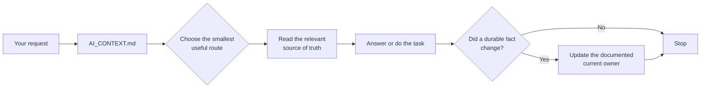
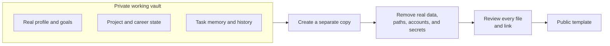

# AI Context Vault

> Give AI the right context—without giving it everything.

AI Context Vault is a **local-first Markdown framework** for long-running work with Codex, Claude Code, ChatGPT, and other AI assistants.

Instead of pasting your full history into every new conversation, you keep a small set of source documents. The AI starts from one protocol, reads only what the current task needs, and writes updates back to the correct place.

This repository is a **sanitized public template**. It contains structure, rules, and placeholders—not a real person's private vault.

## At a glance

| Problem | What this template changes |
|---|---|
| Every new conversation starts cold | The AI begins from one stable entry file |
| Long chats become the only memory | Current facts live in source-of-truth documents |
| Agents read too much personal context | Each request uses the smallest useful reading route |
| Project status, task notes, and history get mixed | Each kind of information has a separate owner |
| A private vault is accidentally treated as publishable | Public templates and private working data stay separate |

## How it works



The important part is not the folder names. It is the discipline:

1. **Start from one protocol.**
2. **Read only enough for the current request.**
3. **Keep each current fact in one authoritative file.**
4. **Use chat history as supporting evidence, not as the database.**

## First recovery example / 第一次恢复上下文

Start with the [fictional beginner example (中文)](examples/first-recovery/README.md). Its filled Markdown files show where current project state and past decisions belong, which files a new conversation should read, and what remains unverified. You do not need to fill a personal profile or read every domain folder.

This example contains no application code, real personal records, or runtime results. Reading it is not evidence that any project has run successfully.

## Quick start

### 1. Make a private working copy

Clone or download this repository, then copy `vault/` into a private Markdown workspace. Obsidian is optional; any ordinary folder works.

Keep `docs/` nearby if you may later publish a sanitized example.

### 2. Fill only what you actually know

Replace the placeholders you need in `vault/00-Profile/` and the relevant domain folders. Leave unknown values blank or use `{{UNKNOWN}}`. Do not invent details just to make the vault look complete.

### 3. Point your AI assistant at the entry protocol

```text
Read and follow {{VAULT_PATH}}/AI_CONTEXT.md.
Use the smallest recovery path that supports this request.
Do not search or read private material unless I explicitly name the file or folder.
```

Codex can use `vault/AGENTS.md`; Claude Code can use `vault/CLAUDE.md`. Both are intentionally small pointers back to the same protocol.

### 4. Before allowing writes, review the sync rules

Read `vault/50-Workflow/SYNC_RULES.md`. It defines where new facts belong, when a project should update its own status, and when a dated log is appropriate.

## A concrete example

Suppose you ask:

> Continue Project Alpha from where we stopped yesterday.

The assistant should not load your entire profile and every past conversation. It should:

1. read `AI_CONTEXT.md`;
2. select the project route;
3. open Project Alpha's current `README`, `WORKLOG`, or `CURRENT_PROGRESS`;
4. use a task-memory note only if the project has no better current owner;
5. update the project document after meaningful progress.

That same pattern works for learning notes, career tracking, recurring workflows, or any other long-running area.

## Where information belongs

| Information type | Canonical home | Example |
|---|---|---|
| Stable fact or current domain state | Relevant domain source of truth | profile goal, current application state |
| Current project progress | The project's own documentation | `README`, `WORKLOG`, `CURRENT_PROGRESS` |
| Cross-session context with no better owner | One task-memory file | an ongoing investigation without a project home |
| Important dated milestone | Weekly or dated log | a completed migration or verified decision |

The rule of thumb is simple: **current state stays with its owner; logs preserve history.**

## Repository map

```text
vault/
├── AI_CONTEXT.md              # first read: routing and privacy rules
├── AGENTS.md                  # Codex entry pointer
├── CLAUDE.md                  # Claude Code entry pointer
├── SYSTEM_STATUS.md           # compact index of current priorities
├── 00-Profile/                # stable preferences and goals
├── 10-Knowledge/              # reusable knowledge
├── 20-Projects/               # project index and project-owned status
├── 30-Career/                 # optional career workflow examples
├── 50-Workflow/
│   ├── SYNC_RULES.md          # where durable updates should be written
│   ├── conversation-handoff.md
│   ├── task-memory/           # fallback for context with no better owner
│   ├── logs/                  # dated history, not current state
│   └── prompts/               # reusable prompts
└── 90-Inbox/                  # temporary, unprocessed capture

docs/
├── PRIVACY_CHECKLIST.md
├── PUBLICATION_GUIDE.md
└── PROJECT_POSITIONING.md
```

You can rename or remove domain folders. The reusable core is:

- one entry protocol;
- minimal context routing;
- one current owner for each fact;
- source-first handoff;
- an explicit privacy boundary.

## Private vault vs. public template



Do **not** publish a filled working vault directly. Removing obvious passwords is not enough: names, employers, local paths, document metadata, account identifiers, and operational details may still be sensitive.

Before any public push or share link, use the [privacy checklist](docs/PRIVACY_CHECKLIST.md) and [publication guide](docs/PUBLICATION_GUIDE.md).

## What this repository is—and is not

### It is

- a reusable Markdown information architecture;
- a context-recovery and write-routing protocol;
- a starting point for private, long-running AI collaboration;
- compatible with Obsidian and ordinary folders.

### It is not

- a note-taking application or agent runtime;
- a secret manager, encrypted backup, or access-control system;
- an automated guarantee that private data cannot leak;
- a reason to make your filled vault public.

## Current status

- **Stage:** reusable public template
- **Contents:** sanitized placeholders and a fictional recovery example
- **Runtime:** Markdown; no service or dependency installation required
- **Privacy checks:** documented manual process, not an automated guarantee

## More documentation

- [Project positioning](docs/PROJECT_POSITIONING.md)
- [Privacy checklist](docs/PRIVACY_CHECKLIST.md)
- [Publication guide](docs/PUBLICATION_GUIDE.md)
- [Workflow guide](vault/50-Workflow/README.md)
- [AI usage guidance](vault/50-Workflow/AI_USAGE.md)

## License

MIT
