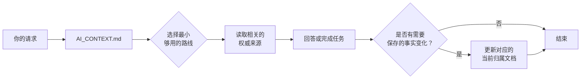
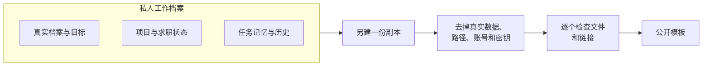

# AI Context Vault

[English](README.md)

> 给 AI 恰好够用的上下文，而不是全部。

AI Context Vault 是一套**本地优先的 Markdown 档案框架**，用于和 Codex、Claude Code、ChatGPT 等 AI 助手长期协作。

你不用在每个新对话里重新粘贴全部背景，只需维护少量源文档。AI 每次从同一份协议开始，只读当前任务需要的内容，并把更新写回正确的位置。

本仓库是**脱敏后的公开模板**，只包含结构、规则和占位内容，不是任何真人的私人档案。

## 一眼看懂

| 常见问题 | 这套模板怎么解决 |
|---|---|
| 每个新对话都从零开始 | AI 总从同一个稳定的入口文件开始 |
| 长对话变成唯一的记忆 | 当前事实保存在各自的权威文档里 |
| 换一个 AI 工具就要重新交代一遍 | 多个工具读同一份档案库，共用一份规则 |
| AI 读了太多个人背景 | 每次请求只走最小够用的读取路线 |
| 项目进度、临时笔记和历史混在一起 | 每类信息有各自的归属 |
| 私人档案被误当成可以公开的东西 | 公开模板和私人档案始终分开 |

## 怎么运作



关键不在文件夹叫什么，而在这几条习惯：

1. **从同一份协议开始。**
2. **只读完成当前请求所需的内容。**
3. **每条当前事实只存在一个权威文件里。**
4. **聊天记录只是辅助证据，不是数据库。**

## 第一次恢复上下文示例

从[虚构的入门示例](examples/first-recovery/README.md)开始。它用填好的 Markdown 文件演示：当前项目状态和过去的决定分别放在哪里、新对话应该读哪些文件、哪些内容仍未验证。你不需要先填写个人档案，也不需要读完每个领域目录。

这个示例不含应用代码、真实个人记录或运行结果，读完它不代表任何项目已经成功运行。

## 快速开始

### 1. 复制一份私人工作副本

克隆或下载本仓库，把 `vault/` 复制到你自己的私人 Markdown 工作区。Obsidian 不是必需的，普通文件夹也可以。

如果以后可能要发布脱敏示例，把 `docs/` 一起留着。

### 2. 只填你确实知道的内容

在 `vault/00-Profile/` 和需要的领域目录里替换占位符。不知道的留空，或写 `{{UNKNOWN}}`；不要为了看起来完整而编造细节。

### 3. 让 AI 助手从入口协议开始

```text
Read and follow {{VAULT_PATH}}/AI_CONTEXT.md.
Use the smallest recovery path that supports this request.
Do not search or read private material unless I explicitly name the file or folder.
```

给每个工具放一个薄入口文件：Codex 和其他读取 `AGENTS.md` 的工具用 `vault/AGENTS.md`，Claude Code 用 `vault/CLAUDE.md`。两者都只指向 `AI_CONTEXT.md` 和 `50-Workflow/COLLABORATION.md`，规则只在一处维护。

### 4. 允许写入之前，先看同步规则

阅读 `vault/50-Workflow/SYNC_RULES.md`。它规定新事实写到哪里、项目什么时候更新自己的状态、什么时候才值得写一条带日期的日志。

## 一个具体例子

假设你说：

> 从昨天停下的地方继续 Project Alpha。

助手不应该加载你的全部档案和所有历史对话，而应该：

1. 读 `AI_CONTEXT.md`；
2. 选择项目路线；
3. 打开 Project Alpha 当前的 `README`、`WORKLOG` 或 `CURRENT_PROGRESS`；
4. 只有项目没有更合适的归属时，才使用任务记忆；
5. 有实质进展后，更新这个项目自己的文档。

学习笔记、求职跟进、日常流程等任何长期事务，都可以沿用同样的方式。

## 一份档案库，多个 AI 工具

很多人同时在用不止一个助手：终端里的编程 Agent、桌面应用、网页聊天。用这套模板，它们都从同一批文件工作，而不是各自维护一份记忆。

- 每个工具只有一个小入口文件，指向同一份协议和同一份规则文件 `vault/50-Workflow/COLLABORATION.md`。
- 换工具不等于迁移。下一个工具读取当前文档就能接着做，不需要上一个工具的聊天记录。
- 同一个文件同一时间只让一个工具写，写之前重新读取最新内容，避免覆盖别的工具的进展。

逐步接入新工具的方法和常见的坑，见[多工具共用](vault/50-Workflow/advanced/multi-tool-sharing.md)。这是可选内容，只用一个工具时核心模板同样可用。

## 信息放在哪里

| 信息类型 | 权威位置 | 例子 |
|---|---|---|
| 稳定事实或领域当前状态 | 对应领域的权威来源 | 个人目标、当前投递状态 |
| 当前项目进度 | 项目自己的文档 | `README`、`WORKLOG`、`CURRENT_PROGRESS` |
| 没有更好归属的跨会话上下文 | 一份任务记忆文件 | 还没有项目归属的持续调查 |
| 重要的带日期里程碑 | 周日志或带日期的日志 | 一次完成的迁移、一个已验证的决定 |

简单记法：**当前状态跟着它的归属走，日志只保存历史。**

## 目录结构

```text
vault/
├── AI_CONTEXT.md              # 首先读取：读取路线与隐私规则
├── AGENTS.md                  # Codex 等工具的入口指路
├── CLAUDE.md                  # Claude Code 的入口指路
├── SYSTEM_STATUS.md           # 当前优先级的精简索引
├── 00-Profile/                # 稳定偏好与目标
├── 10-Knowledge/              # 可复用的知识
├── 20-Projects/               # 项目索引与项目自有状态
├── 30-Career/                 # 可选的求职流程示例
├── 50-Workflow/
│   ├── COLLABORATION.md       # 所有 AI 工具共用的工作规则
│   ├── SYNC_RULES.md          # 需要保存的更新写到哪里
│   ├── conversation-handoff.md
│   ├── task-memory/           # 没有更好归属时的兜底
│   ├── logs/                  # 带日期的历史，不是当前状态
│   ├── prompts/               # 可复用的提示词
│   └── advanced/              # 可选：多工具共用、周摘要、执行记录
└── 90-Inbox/                  # 临时收纳，尚未整理

docs/
├── PRIVACY_CHECKLIST.md
├── PUBLICATION_GUIDE.md
└── PROJECT_POSITIONING.md
```

领域目录可以改名或删除。真正可复用的核心是：

- 一份入口协议和一份共用规则；
- 最小上下文路线；
- 每条事实一个当前归属；
- 以源文档为准的交接；
- 明确的隐私边界。

## 私人档案与公开模板



**不要**直接公开已经填好的私人档案。只删掉明显的密码是不够的：姓名、雇主、本机路径、文档元数据、账号标识和运维细节都可能敏感。

公开推送或分享链接之前，先按[隐私检查清单](docs/PRIVACY_CHECKLIST.md)和[发布指南](docs/PUBLICATION_GUIDE.md)检查。

## 它是什么，不是什么

### 它是

- 一套可复用的 Markdown 信息架构；
- 一套上下文恢复与写入路由协议；
- 私人、长期 AI 协作的起点；
- 兼容 Obsidian 和普通文件夹。

### 它不是

- 笔记应用或 Agent 运行时；
- 密钥管理、加密备份或权限控制系统；
- 私人数据不会泄露的自动保证；
- 把你填好的档案库公开的理由。

## 当前状态

- **阶段**：可复用的公开模板
- **内容**：脱敏占位内容和一个虚构的恢复示例
- **运行**：纯 Markdown，无需安装服务或依赖
- **隐私检查**：有文档化的人工流程，不是自动保证

## 更多文档

- [项目定位](docs/PROJECT_POSITIONING.md)（英文）
- [隐私检查清单](docs/PRIVACY_CHECKLIST.md)（英文）
- [发布指南](docs/PUBLICATION_GUIDE.md)（英文）
- [工作流说明](vault/50-Workflow/README.md)（英文）
- [AI 使用指引](vault/50-Workflow/AI_USAGE.md)（英文）

## 许可证

MIT
